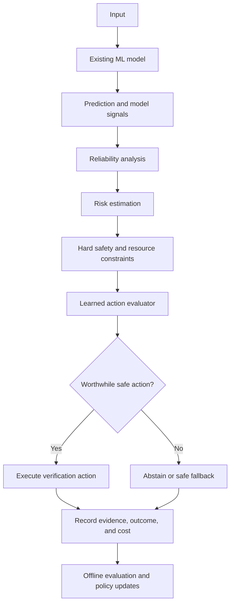

# Proposed VIMARSH Architecture

## High-level pipeline

## Components

### 1. Prediction adapter
Receives predictions and available metadata from an existing model. Model-specific integrations should be isolated behind a consistent interface.

### 2. Reliability analyzer
Computes available reliability signals, potentially including calibrated confidence, entropy, model disagreement, input quality, and shift indicators.

### 3. Risk estimator
Estimates the likelihood and potential consequence of an incorrect prediction. The true label is not available to the online estimator.

### 4. Safety constraint engine
Applies hard rules to remove actions that are unsafe, unavailable, or outside configured resource limits. The learned policy cannot override these constraints.

### 5. Action evaluator
Estimates expected remaining risk and cost for each feasible action. Begin with supervised cost-sensitive learning and evaluate more advanced contextual-bandit approaches only when the data and assumptions support them.

### 6. Verification executor
Executes a supported action or records a clearly labelled simulation. Each action must define its inputs, outputs, failure modes, and cost measurement.

### 7. Feedback and evaluation
Stores action decisions, evidence, outcomes, and costs. Offline evaluation must account for missing outcomes and selection bias.

### 8. Dashboard
Presents reliability signals, decisions, coverage, risk, costs, and experiment comparisons. Visualizations must distinguish measured results from simulated outcomes.

## Architectural invariants

- Hard constraints are evaluated before learned action ranking.
- No test-label leakage into inference-time decisions.
- Every action has a defined execution path and cost/outcome record.
- Simulated and real verification are visibly distinguished.
- Abstention remains an explicit safe outcome.
- The system logs enough information to reproduce evaluation decisions.

## Status

This is a proposed architecture. Components and interfaces may change as the research findings evolve.