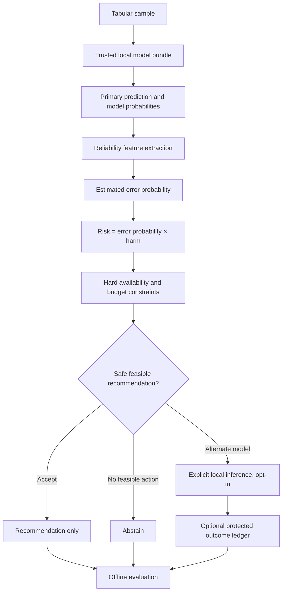

# VIMARSH architecture and implementation status

## Implemented research-preview pipeline

The ordinary decision endpoints are recommendation-only. They do not invoke a human reviewer, acquire external evidence, or automatically execute an alternate model. A separate public local-inference endpoint can run trusted alternate models only after an explicit request. The protected research API can record outcomes, estimate contextual action benefit, and recommend a constrained batch allocation; allocation is not execution.

## Components

### 1. Trusted model runtime
Loads a locally supplied, versioned joblib bundle produced by the research pipeline. The API does not accept model artifacts from end users. The runtime checks the bundle structure, feature schema, model probability outputs, and reliability estimator state before scoring.

### 2. Reliability feature extraction
Combines primary-model probabilities with the project's reliability feature extractor. The feature set and estimator are trained offline. The runtime does not receive ground-truth labels.

### 3. Risk and policy layer
Computes baseline risk from estimated error probability and harm, then applies availability, action-cost, and remaining-budget constraints. The policy can recommend acceptance, an available alternate-model action, or abstention.

### 4. Explicit alternate-model inference
The dashboard can request local alternate-model predictions after a user action. This endpoint returns model outputs and timing only. It does not switch the primary model, use ground-truth labels, or imply that an action improved the final decision.

### 5. Protected outcome research API
When an operator configures `VIMARSH_RESEARCH_API_TOKEN`, protected endpoints support append-only hash-chained outcome recording, aggregate ledger summaries, context-conditioned action-benefit diagnostics, and constrained allocation recommendations. Completed propensity-logged records are required for estimation. The estimator's conservative lower-bound diagnostic is not a formal guaranteed confidence bound and does not establish causal benefit.

### 6. Research dashboard
The React interface loads the runtime feature schema, accepts a tabular sample and decision context, displays the recommendation and rationale, and can explicitly run local alternate models. It is a local research-preview interface, not a production decision console.

## Safety and evaluation invariants

- Ground-truth labels are not accepted by inference-time decision requests.
- Training, validation, and held-out test data remain separated in the benchmark experiments.
- Hard availability and budget constraints cannot be overridden by learned action-benefit estimates.
- Abstention is a valid outcome and must be reported with coverage.
- Alternate-model inference requires an explicit request; there is no automatic model switching.
- Human review and additional evidence are marked unavailable until real providers are implemented and validated.
- Research allocation recommends actions but does not execute them.
- Simulated, measured, and unavailable capabilities must be labelled distinctly.
- A positive offline estimate is not proof of real-world risk reduction or causal benefit.

## Current operational boundaries

- Intended use: local, reproducible research demonstration.
- Model artifacts: generated by the repository's training workflow and supplied through a trusted local path.
- Protected research endpoints: disabled unless a server-side token is configured.
- Outcome ledger: local JSONL by default; hash-chain verification detects tampering, but the file-backed implementation is not a multi-process transactional database.
- Human review and additional-evidence integrations: not implemented.
- Public deployment and production security review: not established by the repository's CI checks.

## Further work

Production use would require, at minimum, durable transactional storage, identity and role management, audit and retention policies, real provider integrations, deployment hardening, monitoring, independent external validation, and domain-specific safety review.